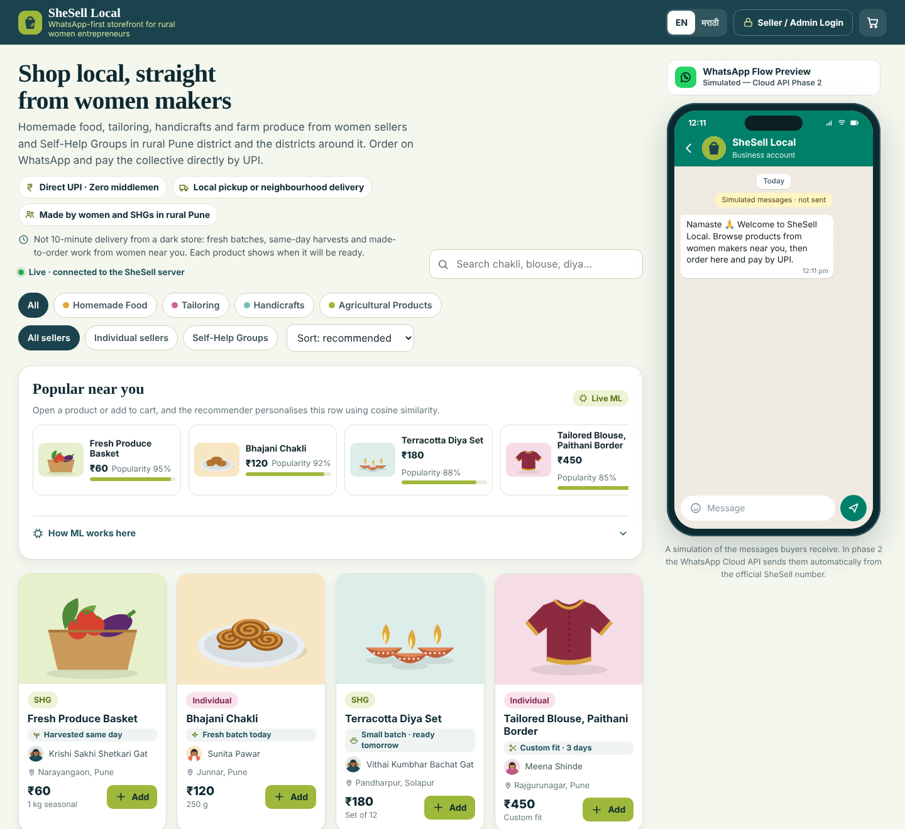
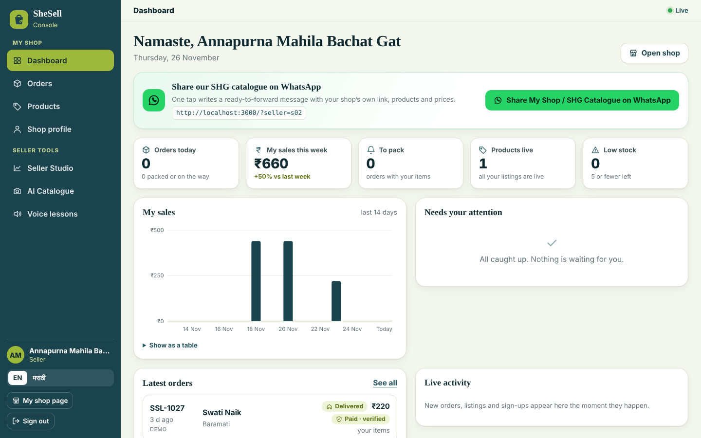
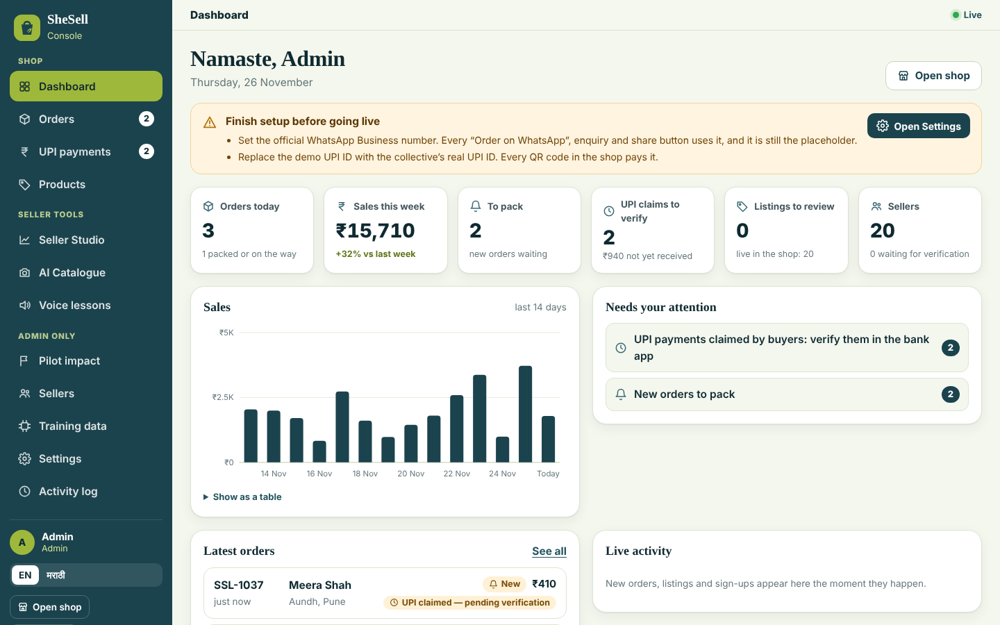
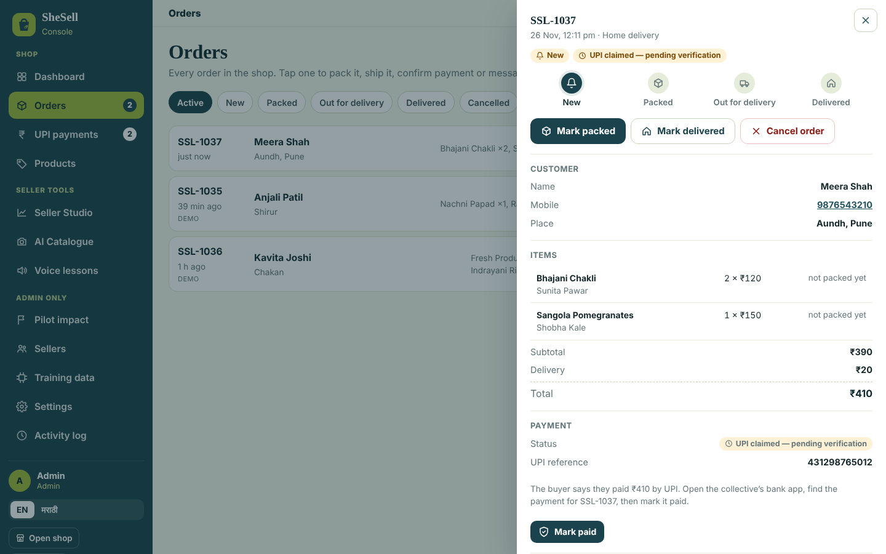
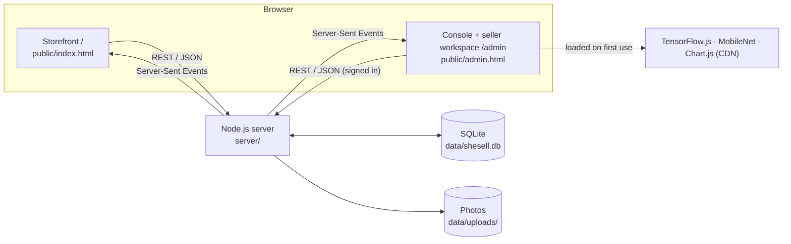

# SheSell Local

A WhatsApp-first storefront for women sellers and Self-Help Groups (SHGs) in rural Pune district and the districts around it (Maharashtra), built by Team AI RANGERS.

It is a full-stack app: a **Node.js + SQLite server** with a REST API and live updates, a **public storefront** for buyers, and a **console** where sellers run their shops and the SheSell team runs the platform. It needs only Node.js; there are no npm packages to install.



## Who uses what

The app has three roles, and each one sees only its own screens. The server enforces the same split on every API route.

| Where | Who | What they get |
|---|---|---|
| **Storefront** `/` | Buyers (no account needed) | Catalogue with category and seller-type (individual / SHG) filters, availability badges on every product, recommendations ranked by cosine similarity, a basket with a UPI QR code for the exact amount, ordering through the official SheSell WhatsApp number, live order tracking, a simulated WhatsApp flow preview, English and मराठी. A **Seller / Admin Login** button in the top bar leads to the console. |
| **Seller workspace** `/admin` | Sellers (mobile number + PIN) | Dashboard, their own orders and products, shop profile, a one-tap **Share My Shop / SHG Catalogue on WhatsApp** message, and the seller tools: **Seller Studio** (TensorFlow.js price and demand model), **AI Catalogue** (MobileNet photo tagger that drafts and publishes listings) and **Voice lessons** in Marathi. |
| **Admin console** `/admin` | SheSell team (`admin`) | Everything above for all sellers, plus admin-only screens: **Pilot impact** dashboard, **UPI payments** (verification queue), listing approval, **Sellers**, **Training data** (CSV import), **Settings** (official WhatsApp number, UPI ID, delivery fees, announcement, shop open/closed), **Activity log** and backups. |



## Run it

1. Install **Node.js 22 LTS or newer** from [nodejs.org](https://nodejs.org). Check with `node -v` (it must be 22.13 or higher).
2. Unzip this folder and open a terminal inside it.
3. Start the server:
   ```
   npm start
   ```
   On Windows PowerShell, if you see "running scripts is disabled", use `npm.cmd start` instead. There is no `npm install` step.
4. Open:
   - Shop: **http://localhost:3000**
   - Console: **http://localhost:3000/admin**
   - On a phone on the same Wi-Fi: use the "On your phone" address printed in the terminal (allow Node.js through the Windows firewall if asked).

**Logins.** The console sign-in page has a small **Demo credentials** panel with everything below.

- **Demo seller:** `9800000001` / PIN `1234` (Annapurna Mahila Bachat Gat, an SHG). A second demo seller is `9800000002` / PIN `1234` (Sunita Pawar).
- **Admin:** login `admin`. A random password is printed in the terminal on first start and saved in `data/ADMIN-LOGIN.txt`. Change it under Console › Settings (the file is deleted then). To choose it yourself, set `ADMIN_PASSWORD` in a `.env` file before the first start.
- **New sellers** can register their own shop from the sign-in page; the admin verifies them under Sellers.

The first start creates the database with the 20-product catalogue, its 20 sellers, and two weeks of sample orders (marked "demo"), so the dashboards have data from the start.

**Updating from version 1.x:** copy your `data` folder into this version and start it. The database upgrades itself: products get an availability setting, and the demo sellers and products move to the Pune-area pilot. Run `npm run reset` if you also want the new sample orders (your admin login stays).

## Before going live: set up WhatsApp and UPI

Every WhatsApp button in the app (Order on WhatsApp, product questions, shop and catalogue shares, price cards, "Message your Saheli") opens a chat with **one official SheSell WhatsApp Business number**, as `https://wa.me/<number>?text=…`. None of them opens WhatsApp's contact picker or anyone else's chat.

Until the admin sets the real values:

- the WhatsApp number is a placeholder (`910000000000`), so WhatsApp reports an invalid number instead of opening a stranger's chat, and buyers see a "Demo shop" note;
- the UPI ID is the demo `shesell.demo@upi`, and buyers are told not to send real money;
- the console shows a **Finish setup before going live** banner on the dashboard and in Settings, and the terminal prints a reminder.

Set both in **Console › Settings**. Every open shop updates at once.



## Demo script (both ends)

Put the shop and the console side by side in two browser windows.

1. **Buyer orders.** In the shop, add a few items, open the basket, enter a name, a 10-digit mobile number and an area, then press **Place order**. Step 2 shows the UPI QR for the exact total and **Send order on WhatsApp** (to the official number). The console shows a "New order" toast at once.
2. **Buyer says they paid.** Press **I've paid by UPI**. Both the buyer's tracker and the console now show **UPI claimed — pending verification**. A QR code can't prove a payment, so nothing is marked paid yet.
3. **Admin verifies.** In Console › **UPI payments**, check the amount in the bank app, then press **Mark paid**. The buyer's tracker changes to **Paid · verified** live, and a WhatsApp update appears in the phone preview.
4. **Fulfil.** Open the order and press **Mark packed**, then **Send out for delivery**. The tracker moves with each step.
5. **Seller lists a product.** Sign in as `9800000001` / `1234`. In **AI Catalogue**, pick a sample photo: MobileNet tags it with its top-3 guesses and scores the photo, the Seller Studio model suggests a fair price, and you pick an availability such as "Made to order · 2–3 days". Press **Publish to storefront**. Her shop is verified, so the product appears in every open shop instantly (listings from unverified sellers wait in Products › **Waiting for review** until the admin approves them).
6. **Seller shares her shop.** On her dashboard, press **Share My Shop / SHG Catalogue on WhatsApp**. The message lists her products, prices and availability, with a link to her own shop page (`/?seller=…`).
7. **Admin controls the shop.** In Console › Settings, set the WhatsApp number and UPI ID: the setup banner disappears, and every WhatsApp button and UPI QR in the open shop changes live.
8. **Train on real data.** In Console › Training data, import `samples/real-sales-sample.csv`. An open Seller Studio retrains on 240 synthetic + 16 real rows.
9. **Show the impact.** Console › **Pilot impact**: LFPR context, the catalogue split, live platform numbers and the 3-month pilot roadmap.

## Availability instead of 10-minute delivery

SheSell is not quick commerce. Each product carries a seller-controlled availability badge, shown on product cards, in the product view, in the basket and in every WhatsApp listing:

| Preset | Badge |
|---|---|
| `fresh_today` | Fresh batch today |
| `small_batch` | Small batch · ready tomorrow |
| `harvest_same_day` | Harvested same day |
| `made_to_order` | Made to order · 2–3 days |
| `custom_fit` | Custom fit · 3 days |
| `ready_stock` | In stock · ready today |
| `preorder` | Pre-order · ready in a week |
| `custom` | the seller's own text, in English and Marathi |

New products default by category (food: fresh batch, tailoring: custom fit, crafts: made to order, farm produce: harvested same day). The shop header and basket also show **Direct UPI · Zero middlemen** and **Local pickup or neighbourhood delivery**.

## UPI payments

| Payment state | Shown as | Who sets it |
|---|---|---|
| `pending` | Unpaid | new orders |
| `claimed` | UPI claimed — pending verification | the buyer, with "I've paid by UPI" (optionally with the UPI reference) |
| `paid` | Paid · verified | **admin only**, after checking the bank app |
| `refunded` | Refunded | admin only |

A buyer's claim can never mark an order paid, and sellers can't change payment states.



## How ML works here

All three models run in the browser, so there is no GPU server to pay for and product photos are analysed on the seller's own device (only the photo she publishes is uploaded). The Node.js server feeds them real data.

| Model | Where | What it learns from |
|---|---|---|
| **Recommender**: content cosine similarity + item-based collaborative filtering | storefront | product features, plus every real order basket from the database |
| **Seller Studio**: TensorFlow.js MLP, 8 → 32 → 16 → 2 (fair price and weekly orders) | seller workspace | 240 synthetic rows for the pilot districts, plus real sales the admin imports as CSV |
| **AI Catalogue**: MobileNet v2 (ImageNet) | seller workspace | pre-trained; the top-3 guesses and photo-readiness scores are stored with each listing for review |

In the Seller Studio, **What the network learned** switches between the model's two outputs: predicted fair price against labour hours, and predicted weekly orders against festival/seasonal demand. A **How ML works here** panel explains this in the Studio and under the shop's recommendations.

## How it works



- **The server is the source of truth.** Prices, stock, delivery fees and totals are computed on the server; the browser's numbers are never trusted. Stock is reserved when an order is placed and returned if it is cancelled.
- **The seller tools live inside the console.** They are rendered in a shadow root that reuses the storefront's design, so the shop and the console styles never clash. TensorFlow.js, MobileNet and Chart.js load only when a seller opens a tool, which keeps the buyer's page light.
- **Live updates** use Server-Sent Events. Each connection gets only what it may see: the public stream gets products and settings; a buyer gets only their own orders (with a private tracking token); a seller gets only orders that contain her products; platform statistics go to the admin only.
- **Security:**
  - every route declares who may call it; the server answers 401 without a session, and 403 when a seller calls an admin-only route;
  - listings can only be published by a signed-in seller (always bound to her own shop, whatever the request says) or by the admin for a chosen seller;
  - passwords and PINs are hashed with scrypt; sessions use HttpOnly, SameSite cookies, and all writes must be JSON, which blocks cross-site form posts;
  - sign-in, order creation and listings are rate-limited; accounts lock after repeated wrong PINs;
  - uploaded photos are checked by their file signature and size, and static files are served without path traversal;
  - every admin and seller action goes into the activity log.
- **Offline demo:** `public/index.html` opened on its own (or on static hosting such as Vercel) finds no server and runs the shop fully in the browser. The console needs the server.

## Project structure

```
shesell-local/
├── server/              Node.js backend (no dependencies)
│   ├── index.js         entry point: HTTP server, pages, uploads, start-up
│   ├── api.js           REST routes and who may call them
│   ├── services.js      business logic: products, orders, payments, listings, sellers, stats, training data
│   ├── db.js            SQLite schema, migrations, demo seed data, setup checks
│   ├── auth.js          password hashing, sessions, rate limits
│   ├── events.js        Server-Sent Events hub
│   ├── http.js          router, JSON bodies, cookies, static files (ETag + gzip)
│   ├── seed.js          first run, demo reset, sign-in page hints
│   ├── config.js        settings from environment / .env
│   └── lib/             csv.js, shared.js (generated: catalogue + data generator shared with the browser)
├── src/
│   ├── app/             buyer storefront (HTML, CSS, JS modules, the shared EN/मराठी dictionary)
│   ├── workspace/       seller tools: Seller Studio, AI Catalogue, Voice lessons, Pilot impact
│   └── console/         console shell, views and its dictionary
├── public/              built pages served by the server (index.html, admin.html)
├── tools/               build.js, dev.js
├── tests/               API, role-boundary and translation tests (node:test)
├── samples/             real-sales-sample.csv for the training-data import
├── docs/                screenshots for this README
├── data/                created at runtime: shesell.db, uploads/, ADMIN-LOGIN.txt
├── .env.example         all settings
└── render.yaml          one-click deploy on Render
```

## API reference

All endpoints take and return JSON. Signed-in endpoints need the session cookie from `/api/auth/login`.

| Method & path | Who | Purpose |
|---|---|---|
| `GET /api/health` | anyone | status check |
| `GET /api/bootstrap` | anyone | shop settings, products, sellers, public stats, order baskets for the recommender, current user |
| `GET /api/settings` | anyone | public shop settings (official WhatsApp number, UPI ID, fees, setup state) |
| `GET /api/products`, `/api/products/:id`, `/api/sellers` | anyone | catalogue and sellers |
| `GET /api/console-info` | anyone | demo hints for the console sign-in page (off when `DEMO_HINTS=0`) |
| `POST /api/events` | anyone | engagement counters (views, shares, cart adds, lessons, trainings, scans) |
| `POST /api/orders` | buyer | place an order → returns the order and a private tracking token |
| `POST /api/orders/track` · `GET /api/orders/:id?t=` | buyer | follow own orders |
| `POST /api/orders/:id/claim` | buyer | "I've paid by UPI" → `claimed`, pending verification |
| `GET /api/stream?track=ID.TOKEN` | anyone | Server-Sent Events, filtered by role |
| `POST /api/auth/login` · `/logout` · `/register` · `/password`, `GET /api/auth/me` | — | accounts (sellers register with mobile + PIN) |
| `POST /api/listings` | seller, admin | publish from the AI Catalogue (photo + CNN output); bound to the seller's own shop; unverified sellers go to review |
| `GET /api/ml/training-data` | seller, admin | rows for the Seller Studio model |
| `GET /api/my/overview` | seller, admin | dashboard numbers (admin: also the setup state) |
| `GET /api/my/orders`, `GET /api/my/orders/:id` | seller, admin | orders (sellers: only those with their products) |
| `POST /api/my/orders/:id/status` · `/pack` · `/note` | seller, admin | move an order forward, pack own items, notes |
| `GET/POST /api/my/products`, `PATCH/DELETE /api/my/products/:id` | seller, admin | manage listings, including availability |
| `GET/PATCH /api/my/profile`, `POST /api/my/lessons/:module` | seller | shop profile, lesson progress |
| `GET /api/stats` | admin | platform statistics for the pilot dashboard |
| `POST /api/admin/orders/:id/payment` | admin | `paid` (verified) / `pending` / `refunded` |
| `GET/POST /api/admin/sellers`, `PATCH /api/admin/sellers/:id`, `POST /api/admin/sellers/:id/login` | admin | verify, pause, edit sellers; create a login or reset a PIN |
| `GET/PUT /api/admin/settings` | admin | official WhatsApp number, UPI ID, fees, announcement, open/closed, synthetic data |
| `GET /api/admin/training`, `POST /api/admin/training/import` · `/rows`, `DELETE /api/admin/training/rows[/:id]` | admin | real sales data for the model |
| `GET /api/admin/audit` | admin | activity log |
| `GET /api/admin/export/{orders,products,sellers,training}.csv`, `GET /api/admin/backup` | admin | exports, database backup |
| `POST /api/admin/orders/clear-demo`, `POST /api/admin/reset` | admin | remove sample orders, restore the demo |

Errors come back as `{ error: { code, message } }`, and both pages translate the code.

## Settings

Copy `.env.example` to `.env` and edit it. Every setting is optional:

- `PORT`, `HOST`: where the server listens.
- `ADMIN_PASSWORD`: the first admin password.
- `DATA_DIR`: where the database and photos live.
- `SEED_DEMO=0`: start with no sample orders.
- `DEMO_HINTS=0`: hide the demo seller login on the sign-in page (set this for a real shop).
- `TRUST_PROXY=1`: set this behind a hosting proxy.
- `ORDER_LIMIT`, `LOGIN_LIMIT`: requests allowed per network address per 10 minutes.
- `MAX_UPLOAD_MB`, `SESSION_DAYS`, `TZ`, `LOG`.

Shop settings (official WhatsApp number, UPI ID, delivery fees, announcement, open/closed) are changed live in Console › Settings, not in files.

## Changing the code

Edit files in `src/`, then rebuild the pages:

```
npm run build      # src/ → public/index.html, public/admin.html, server/lib/shared.js
npm run dev        # rebuilds on every change in src/ and restarts the server when server/ changes
npm test           # API, role-boundary, payment and translation tests on a throwaway database
```

Every visible string lives in the dictionaries (`src/app/js/00-i18n.js` for the shop and the seller tools, `src/console/c00-i18n.js` for the console); the tests fail if a key is missing in either language.

## Deploy

The server needs a host that runs Node.js and keeps files on disk (for SQLite and photos).

- **Render:** push this folder to GitHub, then on render.com choose New › Blueprint and pick the repository. `render.yaml` sets up the service, a 1 GB disk and a generated admin password (see the service's Environment tab). On the free plan, remove the disk block; it still runs, but data resets when the service restarts.
- **Railway / any VPS:** run `npm start`, set `DATA_DIR` to a persistent volume and `TRUST_PROXY=1` behind HTTPS.
- **Vercel:** static hosting only. `public/index.html` there runs as the offline demo; Vercel functions have no persistent disk for SQLite, so the backend needs one of the hosts above.

For a real shop, also set `DEMO_HINTS=0` and fill in the WhatsApp number and UPI ID in Settings.

## Data and backups

- Everything lives in `data/shesell.db` (SQLite) and `data/uploads/`.
- Console › Settings › **Download database backup** saves a copy; CSV exports are next to it.
- `npm run reset` restores the demo data (your admin login stays). `npm run reset-admin` sets a new admin password.
- To start completely fresh, stop the server and delete the `data` folder.

## Troubleshooting

- **"needs Node.js 22.13 or newer"**: install the current LTS from nodejs.org; the database uses Node's built-in `node:sqlite`.
- **"running scripts is disabled on this system"** (PowerShell): use `npm.cmd start`.
- **"Port 3000 is already in use"**: put `PORT=3001` in `.env`.
- **Forgot the admin password**: `npm run reset-admin`.
- **WhatsApp says the number is invalid**: the official number isn't set yet; set it in Console › Settings.
- **The phone can't open the shop**: both devices must be on the same Wi-Fi; allow Node.js in the firewall.
- **Seller Studio or AI Catalogue says a library is missing**: TensorFlow.js, MobileNet (about 14 MB, from TF Hub) and Chart.js come from the internet on first use. Open the tools a minute before a demo. If a network blocks them, the rest of the console keeps working: the Studio asks you to reload, and the AI Catalogue shows a **Try again** button.

## Notes

- The 240 synthetic training rows and the sample orders are generated for the demo and labelled as such; the pilot figures in Pilot impact come from the project deck.
- The WhatsApp phone on the storefront is a **simulated preview** of the messages buyers receive. Sending them automatically through the WhatsApp Cloud API is phase 2.
- Marathi voice lessons use the device's speech voices (Edge and Android have Marathi; Chrome on Windows may use a Hindi voice).
